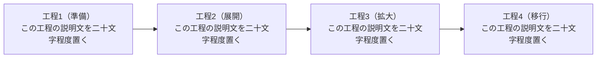

## 1. 本文

{{filler}}

**表1：12 列の数値表（桁の分断の再現）**
*注記: 値はすべて乱数*

| 区分 | 状態 | 組み合わせ | 件数A (件) | 回数 (回) | 金額A (円) | 件数B (件) | 金額B (円) | 件数C (件) | 金額C (円) | 比率 (%) | 備考 |
|---|---|---|---:|---:|---:|---:|---:|---:|---:|---:|---|
| 種別あ (説明文あり) | 状態1: 説明あり | 項目X+項目Y+項目Z (9,999円) | 1,234 | 12,345 | 1,234,567 | 2,345 | 9,876,543 | 3,456 | 7,654,321 | 12.34% | テスト |
| 種別い (説明文あり) | 状態2: 説明あり | 項目X+項目Y (5,555円) | 2,222 | 22,222 | 2,222,222 | 3,333 | 3,333,333 | 4,444 | 4,444,444 | 56.78% | テスト |

**図1：21 カテゴリの積み上げ棒（キャプション分離の再現）**
*注記: 値はすべて乱数*

```chart
{"type":"bar","stacked":true,
 "x":{"label":"日","categories":["D01","D02","D03","D04","D05","D06","D07","D08","D09","D10","D11","D12","D13","D14","D15","D16","D17","D18","D19","D20","D21"]},
 "y":{"label":"回数","min":0},
 "series":[{"name":"系列A","values":[100,120,90,150,160,210,180,250,520,310,270,140,120,50,260,180,400,720,640,400,320]},
           {"name":"系列B","values":[0,0,0,0,0,0,0,0,0,20,40,50,30,60,140,170,540,760,770,440,330]},
           {"name":"系列C","values":[0,0,0,0,0,0,0,0,0,0,0,0,0,0,0,140,470,560,260,70,30]}]}
```

**図2：横方向フローの縮小（LR 図の再現）**


